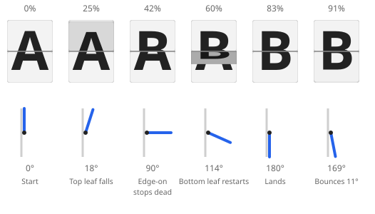
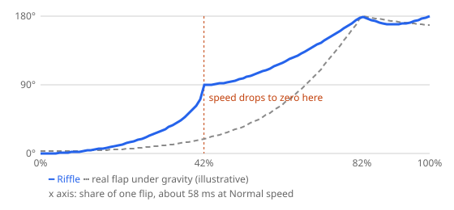
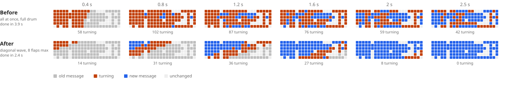

# How the board moves

How one tile flips, and how a whole board changes from one message to the
next. This describes the TV's board, drawn and flipped by `Board` in
`static/js/flapmotion.js` and styled by `static/css/board.css`. The front page's board (`static/js/front_board.js`)
changes message the same way, using the shared parts in
`static/js/flapmotion.js`. Its flip is a lighter version, without the
darkening or the bounce.

The display page's preview flips with the TV's own `Board`, through
`static/js/board_motion.js`, without sound. It turns from the live message
to the new one on Save, when a Routine posts, and from blank on Replay.
While you type it shows your draft without flipping. The motion isn't in
the app's precached shell, so offline the preview is drawn still.

## One flip

Each tile is four layers. Behind are two fixed halves: the top half of the
**next** symbol and the bottom half of the **current** one. In front, on
the split line, are two hinged leaves: the current symbol's top half and
the next symbol's bottom half. A flip from A to B plays the two leaves one
after the other:

1. **The top leaf falls** (the first 42% of the flip). The current
   symbol's top half tips towards the viewer about its bottom edge, from 0°
   to -90° (`rotateX`), easing in and darkening to 45% brightness. The
   next symbol's top half shows behind it as it goes.
2. **The bottom leaf drops** (the other 58%). The next symbol's bottom
   half starts edge-on at 90° and swings down to 0° over the current
   symbol's bottom half, at about 70% of its time.
3. **It lands and bounces.** It kicks back up 11°, then settles at 0°.
   The clack (`sound.clack()`) plays at 65% of the flip.

A flip takes 48 to 68 ms at Normal speed. Each tile picks its own speed
in that range, like the slightly different motors of a real board, so
tiles never move in lockstep. The speed presets scale it: Slow ×1.8,
Fast ×0.5. `perspective` on `.cell` (four tile heights) gives the leaves
depth, and `backface-visibility: hidden` hides each leaf once it passes
edge-on.

### Against a real flap

On a Solari board or a Vestaboard, a flip is one card. Gravity pulls it
over the hinge in one motion that speeds up until it hits the stop at the
bottom, then bounces. Riffle fakes that card with two leaves, and each
leaf starts from rest, so its speed drops to zero edge-on, halfway through
the flip:

At Normal speed this shows as a small hitch in the middle of each flip.
Smoothing it is a possible change for later; RAS-76 left it alone.

## A board change

Each tile turns forward round one drum (`DRUM` in `flaptext.js`): the
blank, A to Z, the digits, punctuation, the colour tiles, then the
pictograms. Tiles that don't change don't move.

A board change runs as a **diagonal wave**. Each row sweeps left to right
(`waveDelay`: 55 ms per column, plus up to 20 ms of scatter), and each row
starts 150 ms after the row above. The change starts top left and ends
bottom right. Ahead of the front, the old message stays still and
readable; behind it, the new message has settled. The speed presets scale
the wave as well as the flips.

A tile also turns **at most 8 flaps** (`SPIN_CAP`). Its last flaps are
the drum's symbols just before its target. From further round, its first
flap goes straight to the first of them (`nextFlap`). On the way to a
letter, digit, mark or blank, those last flaps leave out the colours and
pictograms. So a tile turning to a blank shows `" % , . / ? °` and then the
blank, and never flashes a colour or a pictogram before settling on text.
On the way to a colour or a pictogram it turns through its neighbours on
the drum as before. Each flap still looks like a single flap. Without the
cap, a tile averages about 40 flaps on a typical change, and clearing a
tile means passing every symbol after it on the drum, colours and
pictograms included.

The snapshots show the front page's Trains board changing to its Morning
board. Before RAS-76, almost every tile turned at once (102 of 132 at
0.8 s) and the change took 3.9 s. Now no more than about 40 tiles turn at
once, and the change takes 2.4 s. Why:
[decisions/a-board-change-is-a-diagonal-wave.md](decisions/a-board-change-is-a-diagonal-wave.md).

With reduced motion, or while the page is hidden, tiles snap straight to
their new symbol.

## Tuning it

Every number above is in `DEFAULTS` in `static/js/flapmotion.js`. Staff
can tune them by eye at **/app/design/board/** (linked from the design
page). The page has a live board, a slider for each number, a choice of
boards to change between, and Replay. The sliders change the numbers on
that page only, and nothing is saved. When it looks right, copy the
values from the page over `DEFAULTS` and commit them.
